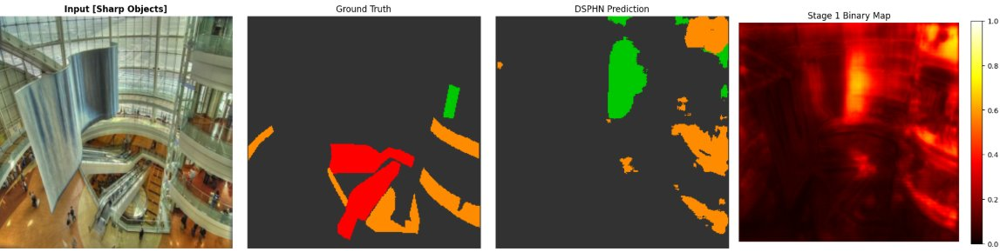
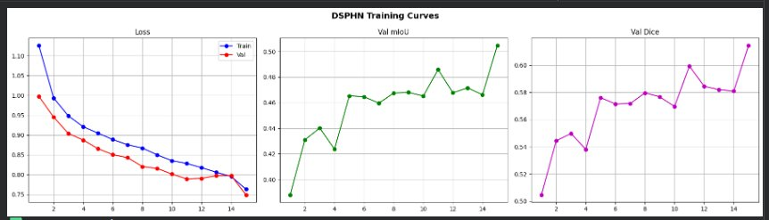

# Dual-Stream Progressive Hazard Network (DSPHN): Indoor Hazard Segmentation

DSPHN is a semantic segmentation architecture that identifies safety hazards in indoor scenes from a single RGB image. Instead of labeling objects by what they are, it labels pixels by the injury risk they pose:

| Class | Injury risk |
|---|---|
| Background | None |
| Safe Floor | Slip/trip |
| Obstacle | Collision |
| Sharp Objects | Laceration |

Built for the Deep Learning for Image Processing course (AIN3002).

📄 [Full report (CVPR format)](report/DSPHN_Report.pdf) · 🖼️ [Poster](DSPHN_Poster.html) (download and open in a browser)



## Architecture

```
Input RGB (3×256×256)
        │
 Shared encoder (64 → 128 → 256 → 512 → 1024)
        │
   ┌────┴─────┐
Appearance   Context
decoder      decoder
(standard)   (dilated)
   └──┬───────┘
 Severity fusion gates
        │
 Stage 1 head → binary safe/unsafe map
        │
 Stage 2 head ([features ; Stage 1 map]) → 4-class hazard map
```

DSPHN has three key components:

1. **Dual-Stream Appearance-Context Decoder:** Two parallel decoders, one using standard convolutions for local texture cues and one using dilated convolutions for spatial context.
2. **Severity-Guided Adaptive Fusion Gates:** Learnable gates, initialised from hazard severity scores, that blend the two streams at each decoder level.
3. **Two-Stage Hazard Refinement:** Stage 1 predicts a binary safe/unsafe map, which feeds directly into Stage 2 for fine-grained four-class classification.

## Data

I used 3,000 ADE20K indoor images remapped to the hazard taxonomy, plus 100 manually annotated images (Make Sense AI) and 186 COCO knife/scissors images to boost the rare Sharp Objects class. The data is split 70/15/15 (2,100 train / 450 validation / 450 test).

## Results

On the held-out test set, DSPHN reached a **mean IoU of 0.4198** and **pixel accuracy of 0.8332**.

| Model | Dual-stream + gates | Two-stage | mIoU |
|---|:---:|:---:|:---:|
| Baseline U-Net | ✗ | ✗ | 0.5771* |
| Dual-stream + gates only | ✓ | ✗ | 0.3894 |
| Two-stage only | ✗ | ✓ | 0.3793 |
| **DSPHN (full)** | ✓ | ✓ | **0.4198** |

\*The baseline was trained without the Sharp Objects class, so it is an easier task and not directly comparable.

The ablation shows the full model outperforms both the dual-stream-only and two-stage-only variants, confirming that the two designs each contribute.

| Class | IoU |
|---|---|
| Background | 0.8081 |
| Safe Floor | 0.5517 |
| Obstacle | 0.3195 |
| Sharp Objects | 0.0000 |



## Limitations and Future Work

Sharp Objects scored zero IoU due to extreme pixel sparsity (about 0.06% of test pixels), despite class weighting and COCO augmentation. Training was also limited to 15 epochs at 256×256 resolution on a T4 GPU.

Future work includes larger balanced hazard datasets, better rare-class balancing (e.g. patch-level oversampling), and a lightweight encoder for real-time edge deployment.

## Training setup

| Setting | Value |
|---|---|
| Input size | 256 × 256 |
| Batch size | 8 |
| Optimizer | Adam, lr = 1e-4 |
| LR schedule | ReduceLROnPlateau (factor 0.5) |
| Epochs | 15 (NVIDIA T4, Google Colab) |
| Split | 70/15/15, seed 42 |

## How to run

1. Open the notebook in [`code/`](code/) in **Google Colab** with a T4 GPU runtime.
2. Mount Google Drive when prompted. The notebook downloads ADE20K and the COCO knife/scissors images, remaps the labels to the hazard taxonomy, then trains and evaluates the models.
3. Install anything missing with `pip install -r requirements.txt`.

Inference with a trained checkpoint:

```python
model = DualStreamProgressiveHazardNetwork(num_classes=4).to(device)
model.load_state_dict(torch.load("best_DSPHN_model.pth"))
model.eval()

with torch.no_grad():
    stage2_seg, stage1_map = model(image_tensor)
    prediction = torch.argmax(stage2_seg, dim=1)   # 4-class hazard map
    hazard_alert = stage1_map                      # binary hazard probability
```

## Repository structure

```
code/
  DSPHN notebook (.ipynb)  # data preparation, training, ablations, evaluation
report/
  DSPHN_Report.pdf         # full report
  main.tex, sec/, figs/    # LaTeX source and figures
DSPHN_Poster.html          # poster
requirements.txt
```

## Built With

Python, PyTorch, torchvision, NumPy, scikit-learn, Pillow, Matplotlib, pycocotools, Google Colab (NVIDIA T4 GPU)


---
Developed by **Mehreen Faisal**, AI Engineering, Bahçeşehir University.
